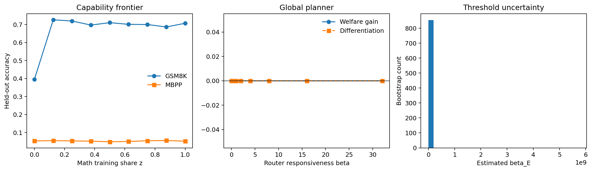

# A Perfect Router Can Create an Imperfect Ecosystem: Model Routing and the Direction of AI Innovation

This history-free, non-LFS snapshot contains the code and compact accepted
artifacts needed for double-blind review of the paper's capability-mixture
experiment. It omits institutional identifiers and large trained adapter state.

## Accepted experiment

The prespecified experiment freezes Qwen3-8B at revision
`b968826d9c46dd6066d109eabc6255188de91218` and crosses nine math-token shares
`z = 0, 0.125, ..., 1` with five paired seeds `{11, 29, 47, 71, 101}`. Each of
the 45 QLoRA arms uses 1,048,576 post-training tokens, one epoch, rank 16,
alpha 32, and learning rate `2e-4`. The primary evaluations use all 1,319
GSM8K test items and all 257 sanitized MBPP test items.

The shared unadapted baseline and the seed-11 profiles at `z = 0, 0.5, 1` are
the four confirmatory MATH-500/HumanEval robustness profiles. The other 42
profiles are exploratory. The design was hash-locked before training but was
not placed in an external registry, so the paper calls it prespecified rather
than preregistered.

## Results



- Every adapted five-seed mean is below the unadapted baseline on GSM8K and
  corrected MBPP.
- Mean MATH-500 accuracy rises from 15.38% at `z = 0` to 29.88% at `z = 1`,
  and the endpoint gain is positive in all five seeds.
- The generalized threshold is not identified because the fitted domain slopes
  at the interior stationary point are nonpositive. The stationary math-share
  bootstrap median is 0.624 with a 95% percentile interval `[0.591, 0.660]`.
- The experiment identifies capability changes under this controlled
  post-training intervention. It does not identify provider investment, R&D
  response, or equilibrium behavior.

The rightmost figure panel is a receipt-bound diagnostic of conditional
threshold draws. Because the point threshold is unidentified and the panel is
dominated by an extreme estimate, it must not be interpreted as a threshold
confidence interval.

## Browsable accepted artifacts

- [`all_profile_means.csv`](artifacts/accepted/all_profile_means.csv):
  five-seed means and standard deviations for all nine mixtures.
- [`confirmatory_results.csv`](artifacts/accepted/confirmatory_results.csv):
  the shared baseline and four-profile confirmatory robustness result.
- [`METRIC_STATUS.json`](artifacts/accepted/raw/METRIC_STATUS.json): which
  metrics are authoritative and why the legacy MBPP score is invalid.
- [`design.json`](artifacts/accepted/raw/design.json): frozen design,
  hyperparameters, revisions, and decision rules.
- [`provenance.json`](artifacts/accepted/raw/provenance.json): pinned assets and
  software versions; only the institution-specific CUDA path is generalized.
- [`analysis_summary.json`](artifacts/accepted/raw/analysis_summary.json), raw
  arm/baseline tables, bootstrap draws, frontier means, game sweep, and seed
  sensitivity: machine-readable inputs underlying the reported conclusions.
- [`compute_summary.json`](artifacts/accepted/compute/compute_summary.json):
  exact recorded runtimes for all successful scientific GPU workloads and their
  scope limitation.
- [`cpu_rescore_summary.json`](artifacts/accepted/compute/cpu_rescore_summary.json)
  and [`cpu_rescore_ledger.csv`](artifacts/accepted/compute/cpu_rescore_ledger.csv):
  terminal accounting for the CPU-only corrected MBPP re-execution.

The original MBPP values are invalid because the process limit was applied to
bubblewrap before namespace creation. The reported MBPP values re-execute saved
candidates in the repaired sandbox. The original MATH-500 string metric is also
invalid; reported MATH-500 values use the corrected strict symbolic scorer.
GSM8K and HumanEval were unaffected.

## Compute

GPU work ran on an institutional Slurm cluster with one NVIDIA HX00 GPU per
independent task. The primary experiment used H100 allocations; robustness
recovery used H100 or H200 allocations. Each task requested eight CPU cores,
224 GiB host memory, 50 GiB node-local scratch, and at most 15 hours 30 minutes
per attempt. The 224 GiB request is host memory, not GPU memory.

The accepted metrics record 155.355 successful scientific GPU task-hours:
94.176 across the 45 adapters, 1.010 for the unadapted baseline evaluation, and
60.169 across 46 robustness profiles. These internal timers exclude model load,
failed/superseded attempts, preparation, and orchestration, so this is explicitly
a lower bound rather than total scheduler allocation. Corrected MBPP rescoring
was CPU-only; its terminal summary and 288-row ledger are included above.

## Reproduction

The locked environment targets Python 3.10 on CUDA-capable Linux:

```bash
uv sync --frozen --extra robustness
uv run python capability_mixture_experiment.py self-test
```

Initialize the accepted design with:

```bash
uv run python capability_mixture_experiment.py init \
  --experiment-dir experiments/qwen3_8b_confirmatory \
  --preset confirmatory \
  --model Qwen/Qwen3-8B
```

The code executes generated MBPP and HumanEval programs. Run those evaluations
only inside a disposable, network-isolated environment with the documented
bubblewrap sandbox and explicit code-execution opt-in.

Site-specific Slurm launchers, scheduler job IDs, operational logs, and release
receipts are omitted because they disclose institutional provenance and are not
needed to inspect the scientific code or accepted results.

## Deliberately omitted large assets

This review snapshot uses ordinary Git files and contains no Git LFS pointers.
It omits the Qwen3-8B base weights, 45 experiment-produced QLoRA adapters,
retained checkpoints, optimizer/scheduler state, and prepared dataset caches.
The exact public base-model and dataset revisions remain pinned in the design
and provenance files. Large experiment-produced state can be released
separately without changing the accepted results in this snapshot.

## License

The authors' code in this snapshot is released under Apache License 2.0; see
[`LICENSE`](LICENSE). Dataset and base-model licenses and revisions are recorded
in `artifacts/accepted/raw/design.json` and `provenance.json`.
